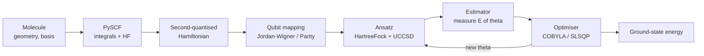

# VQE Tutorial: from Hartree–Fock to Quantum Chemistry on a Quantum Computer

A hands-on path through the **Variational Quantum Eigensolver (VQE)** using [Qiskit Nature](https://qiskit-community.github.io/qiskit-nature/) and [PySCF](https://pyscf.org). Each section is a folder with a README and runnable scripts, ordered from classical baselines to VQE on real molecules.

| # | Section | You learn | Runtime |
|---|---------|-----------|---------|
| 1 | [`01-hartree-fock-basics`](01-hartree-fock-basics/README.md) | The molecular problem, Hartree–Fock, exact diagonalisation, open-shell spin | seconds |
| 2 | [`02-helium-correlation`](02-helium-correlation/README.md) | Correlation energy, first real VQE (UCCSD), why a Hartree–Fock start matters | seconds |
| 3 | [`03-bond-dissociation-vqe`](03-bond-dissociation-vqe/README.md) | Using VQE to get a chemical quantity (bond energy), reproducibility | seconds |
| 4 | [`04-active-space-co2`](04-active-space-co2/README.md) | Active-space reduction so a 30-qubit molecule fits on 8 qubits; cations | 35–50 s |
| 5 | [`05-ccsd-benchmark`](05-ccsd-benchmark/README.md) | The classical gold standard (CCSD) that VQE is compared against | seconds |

## 1. What VQE does

The ground-state energy of a molecule is the lowest eigenvalue of its Hamiltonian H. VQE finds it with the **variational principle**: for any trial state |ψ(θ)⟩,

E(θ) = ⟨ψ(θ)| H |ψ(θ)⟩ ≥ E₀

so minimising E(θ) over the parameters θ approaches E₀ from above. A quantum circuit prepares |ψ(θ)⟩ and measures E(θ); a classical optimiser updates θ.



## 2. The building blocks (and where each script uses them)

| Step | Qiskit Nature / Algorithms object | Choice made in these scripts |
|------|-----------------------------------|------------------------------|
| Molecule | `PySCFDriver(atom, basis, charge, spin)` | STO-3G (minimal); `spin = N_α − N_β` |
| Problem size | `ActiveSpaceTransformer` | Section 4 only |
| Qubit mapping | `JordanWignerMapper` | 1 qubit per spin orbital |
| Starting state | `HartreeFock(...)` | Always used with VQE |
| Ansatz | `UCCSD(...)` | Chemistry-motivated; conserves electron number |
| Optimiser | `SLSQP`, `COBYLA` | Gradient-based / derivative-free |
| Energy evaluation | `Estimator` (noiseless statevector) | Exact expectation values, no shot noise |
| Reference answer | `NumPyMinimumEigensolver` | Exact diagonalisation (full CI) |

**Quantities** (all energies in Hartree, 1 Ha = 27.2114 eV = 2625.5 kJ/mol):
- **Hartree–Fock (HF) energy:** best single-determinant approximation; no electron correlation.
- **Correlation energy:** E_exact − E_HF (negative). VQE's job is to recover it.
- **Total energy:** electronic energy + nuclear repulsion. `result.total_energies` already includes both.

## 3. Setup

```bash
python3.11 -m venv .venv && source .venv/bin/activate
pip install -r requirements.txt
```

The pins are required, not cosmetic (see [`requirements.txt`](requirements.txt)):

| Problem on a fresh install | Cause |
|----------------------------|-------|
| `ImportError` / `Estimator` missing | Qiskit 2.x removed the V1 primitives; use Qiskit 1.x |
| `AttributeError: 'csr_matrix' object has no attribute 'H'` | SciPy ≥ 1.14 removed `.H`; use `scipy<1.14` |

## 4. Pitfalls this tutorial teaches (all reproduced and tested)

| Pitfall | Symptom | Fix | Section |
|---------|---------|-----|---------|
| UCCSD without a Hartree–Fock initial state | VQE returns `0.0` (He) or `−180.41` (CO₂, 4.7 Ha above HF) | `initial_state=HartreeFock(...)` and `initial_point=zeros` | 2, 4 |
| Exact solver ignores particle number | He⁺ "exact" energy is the neutral atom's | Keep only the right (N_α, N_β) sector | 2 |
| Forgetting nuclear repulsion with a bare qubit operator | H₂ energy −1.85 Ha instead of −1.12 Ha, BDE 2413 kJ/mol | Add `nuclear_repulsion_energy`, or use `GroundStateEigensolver` | 3 |
| Random-start, non-conserving ansatz (`TwoLocal`) | Same molecule gives −1.1168 … −1.1373 Ha across runs | UCCSD + HF start, zero initial point | 3 |
| Too-small basis for UCCSD (He/STO-3G) | `ValueError: number of spatial orbitals … must be greater than …` | Use 6-31G | 2 |
| Even electron count assumed for a cation | `The number of inactive electrons must be even` | `num_electrons=(N_α, N_β)` | 4 |
| Sign of a reaction energy | Exothermic reaction printed as +10.76 eV | ΔE = products − reactants | 5 |

## 5. Results at a glance (tested, pinned environment)

| Quantity | Value |
|----------|-------|
| H₂ at 0.735 Å: HF / exact | −1.11700 / −1.13731 Ha (correlation −0.0203 Ha) |
| He (6-31G): HF / VQE / exact | −2.85516 / −2.87016 / −2.87016 Ha |
| H₂ dissociation energy (STO-3G, VQE) | 535.9 kJ/mol (HF: 482.0; experiment 458) |
| CO₂ active space (8 qubits): VQE / exact | −185.1334 / −185.1371 Ha |
| CO₂⁺ active space (8 qubits): VQE | −184.7298 to −184.7300 Ha (not bit-reproducible) |
| C + O₂ → CO₂, CCSD/cc-pVDZ | −10.76 eV (experiment ≈ −11.5 eV) |

## 6. Where to go next

- Few-qubit VQE sweeps over bond length: [`../Hamiltonian/h2-quantum-simulation`](../Hamiltonian/h2-quantum-simulation/README.md) (ParityMapper reduces H₂ to **2 qubits**).
- The phase-estimation alternative to VQE: [`../phase-estimation-basics`](../phase-estimation-basics/README.md).
- Beyond this tutorial: noisy simulators and real hardware (shot noise, error mitigation), ADAPT-VQE, larger basis sets.

## Honest limits

These are noiseless statevector simulations in a minimal basis. They teach the workflow; they are not chemically accurate, and VQE on this scale offers no speed-up over the classical methods used to check it.
